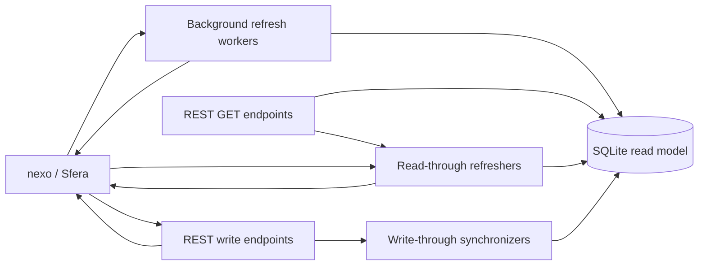

# Materialized Read Model

## Purpose

SubiektNexoConnector uses a durable SQLite read model for data that is expensive to retrieve repeatedly through Sfera. The read model improves GET latency and limits SDK session churn while preserving nexo as the only business source of truth.

The database is a rebuildable projection. It must not be modified by external applications and must not be treated as an integration database shared between adapter instances.

## Data flow



Currently materialized:

- complete product details, including prices, stock, suppliers and custom fields,
- complete party details, including addresses, contacts, classifications, limits and custom fields,
- advanced custom-field definitions for products and parties,
- materialization policies and refresh checkpoints.

Warehouses, basic-field definitions and flag definitions still use live Sfera reads.

## Consistency rules

### Collections

`GET /products` and `GET /parties` never perform a full fallback scan against nexo. They return data only after the corresponding first complete materialization cycle. Before that point the endpoint returns `503 Service Unavailable`.

This avoids duplicating a large refresh when an impatient client retries a collection request while the worker is already building it.

### Individual resources

`GET /products/{sku}` and `GET /parties/{partySignature}` use read-through behavior:

1. Read the current SQLite snapshot.
2. Evaluate its freshness policy.
3. Return it immediately when it is `fresh` or `refresh-due`.
4. For missing or `stale` data, fetch the resource from nexo and upsert SQLite.
5. Read the saved projection and return it.

If a stale snapshot exists and the Sfera refresh fails, the endpoint returns the previous snapshot with `Materialization-Status: stale`. Cancellation requested by the caller or host is not swallowed.

### Writes

Business writes always target nexo first. When Sfera returns a complete DTO, the handler attempts to update SQLite without opening another Sfera session. This covers product create, patch and delete; party create and patch; and party address/contact create, patch and delete.

The SQLite update is best-effort. nexo and SQLite cannot participate in one atomic transaction. A successful nexo operation therefore remains successful if local projection persistence fails. The worker is responsible for eventual repair.

## Freshness metadata

Successful GET responses expose:

```text
Materialization-Status: fresh
Materialization-Age-Seconds: 42
Materialization-Last-Success-At: 2026-10-14T10:15:00.0000000Z
```

Statuses:

- `fresh` — age is below `Lifetime - RefreshAhead`,
- `refresh-due` — refresh should be scheduled soon, but the snapshot is still within its lifetime,
- `stale` — age reached or exceeded the configured lifetime,
- `unavailable` — no successful materialization exists yet.

Non-materialized successful GET endpoints receive default `fresh` metadata with an age close to zero. Validation, authentication and server-error responses do not receive default materialization headers. An endpoint may explicitly attach `unavailable` metadata to a non-success response.

## Current policies

Policy definitions are initialized in code. Their current values and cycle checkpoints are stored in SQLite, which is the first step toward a future policy configurator.

| Policy ID | Candidates | Priority | Lifetime | Refresh ahead | Batch size |
| --- | --- | ---: | ---: | ---: | ---: |
| `products.new` | Present in nexo, missing from SQLite | 300 | 1800 s | 90 s | 500 |
| `products.hot` | `TotalStock > 0` | 200 | 180 s | 15 s | 50 |
| `products.cold` | `TotalStock <= 0` | 100 | 1800 s | 90 s | 500 |
| `parties.all` | Full source-system scan | 150 | 1800 s | 90 s | 100 |
| `additional-field-definitions.advanced.product` | Complete definition resource | 400 | 2700 s | 120 s | 1 |
| `additional-field-definitions.advanced.party` | Complete definition resource | 390 | 2700 s | 120 s | 1 |

Priorities currently order policies inside their own workers. They are not yet a global Sfera priority queue: all workers and HTTP requests ultimately compete for the same serialized executor.

`products.new` discovers records by comparing the highest materialized nexo ID with source candidates. Products are assigned increasing IDs by nexo, avoiding repeated empty scans through old batches. Party refresh uses a cursor and removes projections not observed during a completed full cycle.

## Runtime model

Three hosted `BackgroundService` implementations maintain products, parties and advanced-field definitions. They start with the API process, create a dependency-injection scope for each iteration and propagate the host cancellation token through policy, checkpoint, Sfera and EF Core calls.

Workers do not block `/health` readiness. They share `ISferaExecutor` with HTTP traffic, and that executor currently serializes all SDK work with `SemaphoreSlim(1)`. Each operation still creates, logs into and disposes a Sfera handle. A future priority queue may reuse one session for multiple operations and allow interactive work to overtake maintenance batches.

## Database configuration and migrations

Configure the read model independently from idempotency storage:

```json
{
  "Materialization": {
    "DatabasePath": "data\\read-model.db"
  }
}
```

An absolute path is used as supplied. A relative path is resolved against `AppContext.BaseDirectory`. The application creates the parent directory if needed and opens SQLite in `ReadWriteCreate` mode.

Development currently uses:

```text
data\read-model.dev.db
```

The deployment template uses:

```text
data\read-model.db
```

`ReadModelDbContext.Database.MigrateAsync()` runs before the HTTP pipeline starts. A migration failure prevents startup rather than allowing the API to run against an incompatible schema.

## Rebuilding the read model

The read model is disposable, but only while the API process is stopped:

1. Stop the adapter instance.
2. Resolve the exact `Materialization:DatabasePath` for that instance.
3. Back up or remove only that read-model database file and its SQLite sidecar files, if present.
4. Do not remove `idempotency.db`; it protects write retries and has different recovery semantics.
5. Start the adapter.
6. Confirm that migrations complete and workers begin rebuilding data.
7. Expect collection endpoints to return `503` until their first complete cycles finish.

Never automate deletion using an unresolved relative path or a broad directory target.

## Observability

Sfera completion logs expose separate measurements for:

- queue wait,
- connection and login,
- SDK operation,
- handle disposal,
- total duration,
- queue depth and success.

Worker log scopes include `ExecutionOrigin=MaterializationWorker` and `MaterializationPolicy`. Batch logs report processed records, persistence duration, cycle completion and failures. These fields make API-originated and maintenance-originated Sfera calls distinguishable in Seq.

## Adding another materialized resource

A new vertical should normally provide:

1. Core DTOs that remain independent of EF Core and nexo SDK types.
2. EF Core entities and configurations in Infrastructure.
3. A migration and updated model snapshot.
4. Reader and writer interfaces in Core with SQLite implementations in Infrastructure.
5. A refresher that composes source reads and read-model writes.
6. A policy definition, persisted policy and checkpoint behavior.
7. A cancellation-aware background worker.
8. Collection readiness semantics and individual read-through behavior.
9. Write-through synchronization for relevant mutations.
10. Freshness headers, structured logs and unit/integration tests.

Document resources should follow this shape, but their aggregate boundary, retention window and refresh candidates must be decided before copying the product implementation.

